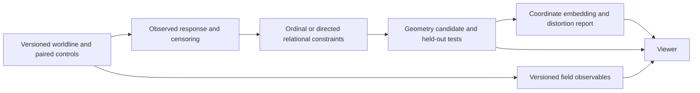

# Emergent Space / Field Viewer — Specification v0.1

- **Date:** 2026-09-08
- **Status:** design proposal for review; documentary stage complete, implementation not started
- **Method:** [M1] instrument design; no new experiment, population claim, or physical promotion
- **Suggested route:** `/lab/emergent/`
- **Suggested public title:** **Emergent Geometry Lab**
- **Canonical document:** `doc/EMERGENT_SPACE_VIEWER_SPEC_v0_1.md` in the website repository

**Reading guide:** sections 2–7 cover physical meaning, the current instrument, the three views, time and promotion criteria; sections 8–10 cover source data and export; sections 11–12 cover architecture and the visible experience; sections 13–17 cover method, execution phases and references.

## 1. Purpose, scope, and reading conventions

Build a new instrument for inspecting whether causal dynamics support a spatial description, and for displaying dynamic quantities on whatever geometry survives independent tests. The visual result should help a human notice patterns and formulate questions. It must not make the appearance of a spatial scene stand in for the demonstration of space.

The proposal separates three views of the same identified objects and compatible observation support:

1. **Relational / Impedance:** a representation of delays and other internal relations.
2. **Emergent Space:** an independently computed candidate geometry inferred from observed causal response; its status may remain ordinal, nonmetric, or unavailable.
3. **Field on Space:** node and edge observables displayed on exactly the selected Space geometry.

The new page belongs to the current DOFT website. It complements `/lab/caldo3d/`, preserves that page and its data, and adds an explicit conceptual boundary between a delay map, an operational geometry, and a field overlay.

This task creates documentation only. It does not implement an exporter, run simulations, estimate a new geometry, alter a detector, edit production HTML/React/CSS, change navigation, commit, push, or deploy. Suggested paths and APIs below are proposals unless explicitly identified as existing.

**Reading convention:** “Observed” means inspected in the current local repository, not independently reproduced physics. “Recorded result” means reported by an identified Study07 record. “Proposed” means a design decision in this specification. “Required” defines acceptance of a future implementation. Historical results retain their original scope and later corrections.

The repository already has a `docs/` corpus; `doc/` did not exist at inspection. This specification uses the singular `doc/` expressly requested for this deliverable, without moving or reorganizing `docs/`. English follows the repository convention and the user's choice for this review.

## 2. Physical motivation and epistemological limits

### 2.1 The question is what dynamics permit us to infer

DOFT's current model evolves internal states and pair delays without supplying ordinary spatial coordinates for onions. That makes it possible to ask whether a spatial description can be reconstructed from causal behavior. It does not establish that such a description exists, that it is unique, or that it has three spatial dimensions.

An illustrative measurement is a paired intervention on source `a`, compared with an otherwise matched control:

\[
G_j^{(a)}(s)=\|x_{S,j}^{\mathrm{intervention},a}(s)-x_{S,j}^{\mathrm{control}}(s)\|_2.
\]

An arrival detector can extract an onset, interval, rank, or censored non-detection from this response. The result depends on the channel, probe, amplitude, detector, retained history, sampling, observation window, and state. It is an operational measurement, not a primitive distance. The source/control pairing is essential: similarity, correlation, and frequency affinity alone do not establish inter-onion causal influence.

Three different quantities must remain distinct:

| Quantity | Meaning here | What it does not establish |
| --- | --- | --- |
| `s = tick × dt` | External evolution parameter used by the current model | An emergent physical clock |
| `τ_ij(s)` | Internal delay/read-history relation for a pair | Spatial separation or a measured signal arrival |
| `T^(a)_j`, arrival rank, response | Detector-dependent observation of the intervention/control difference | A universal travel time, metric, or signal speed |

The notation follows Study07 [S4]. Its warning matters: the model uses `s` materially and is **not established to be invariant under reparameterization**. Hiding `u.t.` in a viewer does not remove the model's external parameter. A display can respect this epistemic limit while retaining exact integration metadata for reproducibility.

### 2.2 Delay is a two-point quantity

`τ_ij` naturally lives on a pair. It can be described as a relational kernel or an edge observable. A nodal summary of it is a derived statistic with its own definition. Neither automatically becomes a scalar field `φ(x)` over a physical manifold.

Similarly, directed response, gain, or an antisymmetric arrival residual may be displayed on edges. Calling them a connection, curvature, holonomy, flux, or gauge field requires additional definitions and discriminators. In particular:

- The current caldo stores `τ_ij = τ_ji` by construction; directed measured arrivals can still differ. Delay asymmetry and response asymmetry must not be conflated [S1, S8].
- A field of arrows is not evidence for a vector field in physical space. A vector reconstruction requires a declared basis and an inference from edge measurements.
- A node's `e_Q` is the model's layer observable. Calling it thermodynamic temperature requires a calibration beyond its existing display convention.
- A response Gram matrix `G = Jᵀ W J` with positive semidefinite `W` is positive semidefinite by construction. It cannot discover a Lorentzian negative direction through eigendecomposition. This constrains the candidate discussed in L15 [S5]; the current proposal does not inherit its suggestion that such a signature might simply appear in that Gram matrix.
- Geometry in intervention/state space is not automatically geometry of relations between onions. L15's proposed bridge to held-out arrival order is a test to perform, not an identification to assume.

### 2.3 What the instrument may claim

The first defensible product is a comparison of representations, with their assumptions and failures visible. A pattern can motivate a preregistered measurement. It cannot add a vote to a physical claim, confirm dimensionality, establish a particle boundary, or demonstrate gravity.

No universal speed, spatial unit, Euclidean dimension, metric signature, preferred origin, or physical simultaneity is introduced to make the picture familiar. Screen pixels and playback seconds are presentation units. Normalizations needed by an estimator are explicit conventions whose effects must be tested.

Conceptual context is available in Sumati Surya's [causal set review](https://arxiv.org/abs/1903.11544): causal sets have specific order and discreteness assumptions. This is background for asking careful questions, not a claim that Study07 realizes causal set theory. Arrival rankings are not by themselves a causal set of spacetime events.

## 3. What exists today, and what the audit changes

### 3.1 Website structure actually inspected

The website is a React/Next.js App Router project with Vinext/Vite development and build scripts. It is not an Astro application. Existing files include:

| Existing file | Relevant responsibility |
| --- | --- |
| [website/app/page.tsx](../website/app/page.tsx) | DOFT overview; Study07 summaries; `τ-Lab` navigation and links to `caldo3d` |
| [website/app/dynamics/page.tsx](../website/app/dynamics/page.tsx) | Evidence-led Study06 page, source links, glossary, explicit interpretation limits |
| [website/app/layout.tsx](../website/app/layout.tsx) | Shared document shell, English language, metadata, global stylesheet |
| [website/app/globals.css](../website/app/globals.css) | Paper/ink/orange/teal palette, typography, `.page-shell`, `.status-strip`, `.site-header` |
| [website/lib/site.ts](../website/lib/site.ts) | `assetPath`, `absoluteAssetUrl`, configurable base path |
| [website/public/lab/caldo3d/index.html](../website/public/lab/caldo3d/index.html) | Standalone Canvas 2D implementation of a projected 3D scene; controls, inspector, playback |
| [website/public/lab/caldo3d/data/index.json](../website/public/lab/caldo3d/data/index.json) | Lazy-load catalog of run JSONs |
| [website/public/lab/lenguas/index.html](../website/public/lab/lenguas/index.html), [f0scan/index.html](../website/public/lab/f0scan/index.html) | Other existing standalone lab routes |
| [website/next.config.ts](../website/next.config.ts) | Conditional static export, trailing slash and base-path configuration |
| [.github/workflows/deploy-website-pages.yml](../.github/workflows/deploy-website-pages.yml) | Builds `website/out/` with `npm run build:pages` and publishes to GitHub Pages |
| [website/tests/rendered-html.test.mjs](../website/tests/rendered-html.test.mjs) | Existing server-rendered page checks; not a scientific or `caldo3d` interaction test suite |

At inspection, the catalog contained **17 runs**, with `N` in `{25, 26, 50, 84, 150}`. Their run JSON files occupied **46,437,146 bytes**, excluding optional auxiliary files. This is a storage inventory, not a new scientific statistic. The catalog should not be copied into a new all-runs startup download.

`website/.openai/hosting.json` exists but contains only `d1: null` and `r2: null`; it does not identify an active Sites project. The production deployment route observed in code is GitHub Pages. Preserve that arrangement; this proposal does not migrate hosting or add a backend.

### 3.2 The current movie pipeline

The inspected Study07 path is:

```text
worldline chunks + manifest
  → tools/viz_caldo.py
  → docs/viz/datos.json + docs/viz/caldo_3d.html
  → tools/export_web.py
  → website/public/lab/caldo3d/data/{run_id}.json + index.json
  → existing standalone index.html
```

`tools/viz_caldo.py` [S6] reads state traces with decimation `DEC=8`, aggregates delay samples into `PASO=0.5` engine-unit windows, and forms the symmetric dissimilarity:

\[
D_{ij}=\log(1+\overline{\tau}_{ij}/\tau_s),\qquad \tau_s=8\times10^{-4},\quad D_{ii}=0.
\]

`mds9(D)` double-centers squared dissimilarities, diagonalizes `B = −½ J D² J`, and retains up to nine coordinates after clipping negative eigenvalues. `procrustes` aligns successive coordinate sets by an orthogonal transform. Frames contain:

```text
t, pos9, ntot, rms, e, b, fid, fidp, eucl, ut
```

Here `rms` uses the sum of the first three state positions, `e` is rounded `log10(max(mean(e_Q), 1e-6))`, and `b` is window-averaged `b_Q`. The legacy JSON has already aggregated and rounded data; these fields are not unprocessed observations.

Separately, one-engine-unit windows produce frequency-affinity edges using FFT peaks and `|Δω| < 0.275`. Complete-graph component labels are computed before the drawn edge list is capped at 4,000. These are **frequency-affinity edges, not the transport graph and not a phase-lock certificate**.

The existing Canvas renderer adds perspective, orbit/zoom, display scaling, axis triples, opacity, node size/color, optional component hulls, and optional W/port overlays. It also computes some display diagnostics in JavaScript (`O_T`, `H_ω`). Those choices are part of the historical instrument. Copying them into a new viewer would not make them a spatial inference.

The exporter [S7] currently writes into a hard-coded local website path. It also copies optional `capas` and `lenguas` files. The standalone HTML has local-server regeneration hooks (`/estado`, `/regenerar`), but the new static page must not depend on those endpoints.

### 3.3 Relevant recorded results, with scope preserved

| Source record | What it contributes to this design |
| --- | --- |
| L01-T4, 2026-08-20 [S2] | On K1 checkpoint `ck_0040`, the audited transform/MDS pipeline substantially distorts relationships. Recorded 9D stress is 0.729; 43.7% negative spectral mass is discarded. An additive offset intervention strongly moves a displayed node. The record disallows reading physical distance, routes, angles, or closeness in the visible triple from this map. These are results for the audited snapshot, not recomputed statistics for all website movies. |
| L02 / §159-b [S3, S10] | Eight-source tomography supports a common ordinal description under its protocol. It does not establish a metric or continuous geometry movie. |
| §168-b, 2026-08-27 [S11] | The recorded threshold check preserves high `C_ord` at three thresholds, but high-threshold coverage collapses. The stronger nearly-integrable-background / fixed-defect reading does not survive the entire threshold/estimator grid. Display coverage and detector dependence alongside ordinal consistency. |
| L17 and 2026-09-07 record [S12] | Channel, band, reference model, and occupancy calibration can change the inferred spectral graph. Frequency-affinity or lock overlays must carry their exact detector and verdict; graph appearance is not causal evidence. |

The offset experiment deserves precise wording. Adding `a_i+a_j` **changes the numerical pair matrix**; it does not leave all relations unchanged. It shows sensitivity to a separable nodal component. Treating that component as a removable nuisance is a further hypothesis. The new geometry must test it, not subtract it automatically and call the residual space.

The current `caldo3d` introduction includes stronger emergent-space wording than this specification permits. That discrepancy is recorded here, without editing or rewriting the historical page. The new page explains the distinction and links to the existing instrument. Any later wording correction to the old page is a separate editorial change.

## 4. Three views, three contracts

| View | Input allowed to determine coordinates/layout | What may be shown | Required label and limits |
| --- | --- | --- | --- |
| **Relational / Impedance** | Legacy `pos9`, or a separately versioned relational embedding derived from delay/response profiles | Delay structure, nodal summaries, affinity, optional field-like diagnostics | `Relational map · delay-derived` or exact alternative. Coordinates have no spatial status. “Impedance” is a qualified proxy, not a measured impedance unit. |
| **Emergent Space** | A geometry artifact inferred offline from observed response/accessibility/order, with a declared estimator and diagnostics | Ordinal constraints, directed network, candidate distances and embeddings, uncertainty | `Ordinal structure`, `Candidate geometry`, or `Operational space — [scope]`. Never silently substitute legacy coordinates. |
| **Field on Space** | The exact same `geometry_id` and `embedding_id` selected in Space | Node scalars and directed/undirected edge observables on that support | `Field overlay on [geometry status]`. Changing the field does not change positions, scale, camera, visible population, or geometry validity. |

### 4.1 Relational / Impedance

Provide a legacy comparison mode through a read-only adapter. Name the transform and source version explicitly. Preserve historical coordinates if reproducing a historical movie; a corrected computation becomes a different representation/version. Never infer current genome identity from `N` or from a run-name substring if actual provenance is unavailable.

The view may also show a matrix or a directed relation graph. Positions in a force-directed drawing are labeled `layout`, not `geometry`. No “nearby” tooltip should imply physical proximity.

### 4.2 Emergent Space

The panel exists even before a spatial embedding does. Its honest initial state can be an ordinal constraint graph and a message explaining which measurements are missing. Ordinal data should remain inspectable without a 3D scatterplot.

A candidate embedding requires a pre-existing geometry object, with an explicit scope such as population, reference state, source set, channel S, probe protocol, and detector. The geometry can be incomplete, directed, nonmetric, or high-dimensional. The renderer accommodates those results rather than forcing a Euclidean answer.

If several reconstructions satisfy the data, export the ambiguity, alternative candidate IDs, or uncertainty over relations. One attractive layout must not hide non-identifiability.

### 4.3 Field on Space

For a given support/window, selecting `e_Q`, `b_Q`, response magnitude, frequency, or an admissible edge observable uses the existing positions unchanged. Field definitions name the channel, operator, averaging, units, validity, and source window. A quantity used in fitting the geometry can still be displayed, but its correlation with the geometry is marked **not independent**.

Default rendering uses node colors and sparse edge glyphs. No continuous volume, smooth cloud, or interpolated scalar surface is required in v0.1. Such a surface would add a kernel, bandwidth, neighborhood convention, and a continuum assumption. It belongs to a separately declared visualization mode, never the default scientific object.

Two future comparison modes must be separate:

- **Evolving geometry:** field at each window on its corresponding tested geometry.
- **Fixed reference geometry:** successive field observations on one frozen reference support, with the reference window displayed. This is a comparison convention; it does not assert that space stayed fixed.

If Space is unavailable, Field on Space is unavailable too. The observable remains accessible in a table or in the explicitly relational panel. No fallback to MDS(τ) is called Field on Space.

## 5. Time, events, and movie semantics

### 5.1 Four levels that cannot be renamed into one another

| Level | Data object | Honest display |
| --- | --- | --- |
| Archive order | Chunk/tick/window sequence from a simulation | `Observation window 12`; engine coordinates in provenance |
| Response order | Earlier/later detections relative to a particular source intervention | `Response order · source F2 · detector A` |
| Event causal order | Independently defined events and justified precedence relations | `Causal layer`, only after the event and precedence definitions pass validation |
| Emergent clock | A calibrated, valid local or global clock observable | Its operational name, support and uncertainty; physical-time language only after separate validation |

**Initial default:** step through observation windows if those are the only synchronized data available. Do not rename uniform engine windows “causal slices.” The main control shows window number and coverage; it does not present `u.t.` as the world's elapsed time. A provenance drawer retains absolute ticks, `dt`, derived `s`, decimation and offsets.

For a single tomography snapshot, an animation can reveal detected responses in rank order around the fixed reference state. Label this **response-order playback**. Its frames are not successive independently inferred geometries of the evolving population.

### 5.2 `C_ord` is not an event clock

The inspected `orden_causal.py` [S9] builds a directed graph whose vertices are **unordered source–destination pairs**. Within a cone, an edge compares two pair arrivals with at least the sealed two-tick margin. Reciprocal pair identification is an explicit assumption of that consistency test. The cycle-removal heuristic produces `C_ord`; it does not discover event-to-event causal precedence.

Consequently, neither the graph's topological ordering nor its cycle-pruned version supplies physical time, simultaneity, or a unique spatial metric. An earlier response at j than k does not by itself demonstrate that j caused k.

For a future event view, define an event as an occurrence with an ID, onion/branch identity, observation operator, source support and uncertainty. Distinguish:

- **Model dependency:** a state update consumes an earlier retained state, possibly through interpolation. Record read coordinates and interpolation support; do not invent a unique emission event from an interpolated value.
- **Operational response:** a controlled intervention changes an observable at another onion.
- **Ordering constraint:** one detected response precedes another under the selected detector.

Only a declared precedence construction can produce causal layers. In a validated event DAG, incomparable events can share a display layer; incomparability does not prove physical simultaneity. Layering is nonunique and must be versioned. An aggregate onion network may contain cycles even when its time-expanded dependency graph is acyclic. Cyclic/noisy inferred relations are retained as conflicts, not silently removed to make a timeline.

### 5.3 Local clocks are a research branch

Candidates include cycle counts of a valid observable, accumulated activity, or a monotonic internal quantity. None is installed as the clock merely because it is available. `b_Q`, for example, can be flat or uninformative in a relevant regime; it is not universally invertible. Cycle counting requires resolved phase, amplitude validity, unwrap rules, and a treatment of gaps.

A clock candidate must declare zero and normalization conventions; monotonicity, resolution and uncertainty; behavior through inactivity and missing observations; and tests of synchronization or failure to synchronize across onions. Multiple local clocks with no global reconciliation are a valid outcome.

Order-preserving re-labeling of a recorded sequence is a display invariance. It is not a new simulation proving the model is reparameterization-invariant. Detector thresholds expressed in ticks or sampled derivatives may not be invariant under changing sampling; those tests are distinct.

### 5.4 Playback must not manufacture dynamics

- Playback speed is labeled `windows/screen second` or `events/screen second`. It controls viewing, not a physical rate.
- v0.1 uses discrete states, starts paused, stops at the end, and preserves gaps. No default loop joining the end to the beginning.
- Skipped windows and censored intervals remain visible. Do not compress them into an unexplained continuous trajectory.
- Display interpolation, if added later, is off by default, visibly labeled, and never sampled by a measurement tool or exported as observed data.
- Split views synchronize by explicit branch/support/window mapping. Equal frame index, equal `u.t.`, or equal genotype does not establish common physical time or common individual identity across runs.

## 6. Geometry must exist before its embedding

### 6.1 Required dependency order



Deleting every coordinate array must leave a meaningful geometry artifact and allow its scientific tests to run. Changing the renderer must not change any geometry verdict. Geometry and embedding receive different IDs, versions, hashes, and test reports.

### 6.2 A minimal coordinate-free object

An initial object can contain stable onion identities, source-conditioned response detections, pair comparisons, accessibility observations, masks, confidence/resolution information, and conflict records. For example:

\[
\mathcal C=\{a,j,k,\;T_j^{(a)}<T_k^{(a)},\;\text{margin},\;\text{detector},\;\text{support},\;\text{validity}\}.
\]

A non-detection means “not detected by this operator within this horizon.” It is not infinite distance or absence of any interaction. A tied or unresolved arrival is not a zero-length separation.

The first model family should preserve directed source-conditioned information. A symmetric ordinal candidate may additionally seek `d(a,j)<d(a,k)` on compatible comparisons, but symmetry is a hypothesis with its own residuals. Do not average `T(a→b)` and `T(b→a)` before retaining and testing their difference.

Distances are identifiable only to the extent the observations constrain them. Ordinal order alone leaves many magnitude assignments possible. A normalization such as median admitted separation equal to one is a gauge convention for a candidate, not a discovered unit. It must not become a hidden `c=1` conversion from engine latency to spatial length.

### 6.3 Diagnostics before coordinates

Run offline, on the full admitted relation set, before any visual edge sampling:

1. Coverage by source, destination, channel, detector, window and population stratum; reasons for exclusion and non-adjudication.
2. Rank constraints, ties, conflicts and cycles; compare against declared nulls while reporting exactly which graph is being tested.
3. Directed asymmetry and sensitivity to separable emission/reception latencies. Residual subtraction is a model comparison, not a guaranteed purification.
4. If a metric candidate is proposed: non-negativity, diagonal convention, symmetry and triangle residuals with uncertainty and coverage. Retain negative residuals or violations in the diagnostic layer rather than silently clipping them into a metric.
5. Predictive validation on held-out sources, interventions, windows or populations. Hold out whole relevant units, not correlated individual edges that leak source/state information.
6. Stability to permitted detector/threshold/band changes, sampling and resolution, probe amplitude/channel, retained history, and integration-era differences. Scope may be frequency- or state-dependent.
7. Intrinsic-dimension or topology analyses only after defining the object and scale on which they operate. Report uncertainty and model dependence; three displayed axes are never the dimension estimate.

Shortest-path closure imposes a composition law. If used, it is a named model whose predictions must beat appropriate alternatives on measured propagation. Triangle inequalities satisfied by construction after that closure are not independent evidence for metric space. This directly addresses L01's failed road-like composition assumption [S2].

A Euclidean Gram-spectrum diagnostic tests compatibility with that embedding family. Negative eigenvalues indicate incompatibility with exact Euclidean realization under the chosen dissimilarity; they are not a discovered physical time direction. A positive response Gram matrix has the opposite limitation: its positivity is imposed by its construction.

### 6.4 Embedding and gauge

An embedding is a rendering approximation to the admitted geometry. Export its algorithm, dimension, initialization, seed, convergence, normalization, objective and residuals. Report both geometry quality and embedding distortion; one “fidelity” bar must not combine them.

For distance candidates, a declared stress can compare original admitted `d_ij` against `||x_i−x_j||`, with weights and denominator recorded. For ordinal candidates, use violated held-out comparisons and margins. Include local distortion/coverage because a low global error can hide the most distorted short pairs. Empty denominators and disconnected supports yield `not_evaluable`, not a perfect score.

Temporal alignment may remove translation and rotation; reflections require an explicit policy. Scaling is not freely fitted away when changes of scale are a quantity of interest. Orthogonal Procrustes is a presentation gauge, not physical motion. Degenerate eigenspaces and changing population support can make axes unstable; record alignment residuals and common anchors. Do not infer speed, acceleration, chirality or trajectories from gauge-aligned coordinates without a separate operational definition.

Disconnected components have no justified relative placement. Show them as separate panels or visibly arbitrary packed components; do not report their separation. A high-dimensional or non-Euclidean object can remain a matrix/graph or a distorted 2D/3D projection. Failure to fit a familiar scene is an acceptable scientific outcome.

## 7. Promotion criteria: when may the page say “space”?

Promotion is an offline scientific decision recorded in a verdict, not an automatic UI threshold or an inference by the viewer. The following ladder governs terminology:

| Stage | Minimum evidence/product | Permitted label | Still prohibited |
| --- | --- | --- | --- |
| R0 | Reproducible relation data or legacy display artifact | `Relational representation` | Physical distance, physical time, dimensionality claims |
| R1 | Calibrated response/order extractor, coverage and conflicts, tested ordinal agreement in a stated scope | `Operational ordinal structure` | Unique metric; event causal order inferred solely from arrival ranking |
| G1 | Explicit coordinate-free geometry model, characterized identifiability and uncertainty, synthetic discrimination, held-out predictive value | `Candidate geometry` | Unqualified space; promotion from good training fit |
| S1 | Independent measurements show stable operational neighborhood/separation and composition where claimed, controls distinguish nodal latency/detector effects, adequate coverage and replication in the stated regime | `Operational space — [population/protocol/regime]` | General physical space outside the tested scope |
| S2 | Prospective population-level evidence under M2, complete accounting and preregistered discriminators, independent verification and scope extension | A specifically justified emergent-space claim | Spacetime/relativity/field-law claims without their own tests |

M1 can qualify an instrument or a local mechanism. It does not produce the program's general physics. S1 must remain scope-limited; S2 requires the M2 process [S1].

Before a promotion run, preregister the estimator, nulls, equivalence/tolerance bands, coverage floor, statistical unit, holdouts, multiplicity handling, acceptable sensitivity, and failure states. This design does not invent numerical physical thresholds from the desired appearance. Historical thresholds such as `C_ord ≥ 0.99` belong to their original protocol, not to a universal Space switch.

Required discriminators include pure nodal-delay nuisance versus pair structure, independent onions under the same detector, changed probe/detector with retained coverage, source-to-source prediction, and interventions expected to alter response independently of the display. Changes in representation alone cannot pass a gate.

Use `failed`, `not_evaluable`, `not_adjudicated`, and `withdrawn` distinctly. If the data support only directed or ordinal structure, retain that result indefinitely. A usable three-view instrument does not require a successful physical promotion.

## 8. Study07 inputs: available material, missing material, and export scope

### 8.1 Inventory at this inspection

| Input | Existing location in Study07 | Availability and intended use |
| --- | --- | --- |
| Legacy movie aggregate | `docs/viz/datos.json` | Present, 55,415,719 bytes. Source for a historical relational adapter, not a source of new causal geometry. |
| Existing run exports | Website `public/lab/caldo3d/data/` | Present. Rounded coordinates/fields plus affinity edges and genotype information; no complete observation/provenance contract. |
| K1 intervention/control/arrivals | `data/caldo/K1_kick.npz`, `K1_control.npz`, `K1_llegadas.npz` | Present locally. Useful for a bounded single-source audit fixture after identity/integrity validation. One source cannot qualify global geometry. |
| Eight-source sealed arrivals | `docs/bitacora/anexos/2026-08-22_s159b/s159b_cord_resultado.json` | Present. `conos[cone].fuente_onion` and `t_llegada_ticks` supply the existing calibration input; `tests/test_orden_causal.py` demonstrates its reconstruction. These arrivals are derived observations, not raw worldlines. |
| Threshold/estimator robustness | `docs/bitacora/anexos/2026-08-27_s168/s168_resultado.json` | Present. Carries per-threshold results, sanity checks and recorded interpretations. Export only fields actually present; do not presume it includes every raw response curve. |
| Original tomography film root | `/Users/cagostino/s158_f2/datos` referenced by the historical analyzers | Not present at inspection. Re-extracting detections or evaluating a new detector requires recovering the corresponding source archive. |
| Caldo movie worldline roots | `/Volumes/ExternalDisk/doft-study07/m2_censal` and `/Volumes/ExternalDisk/doft-study07/caldo1` in `tools/viz_caldo.py` | Neither present at inspection. Regenerating the complete legacy movie collection is not currently reproducible from those paths alone. |
| Auxiliary layer/port work | `docs/viz/data_capas/capas_a2tiempo_a2control_s20260809.json`; producer `tools/capas_v7.py` | Present. Optional windows contain `f_in`, `f_out`, `w_top`, `cierre`. Semantics, sign, aggregation and calibration must be read from its producer before migration. |
| Film reader for recent detector work | `src/study07/instruments/film_caldo.py` | Present. Reuses the sealed census conventions and explicit mother/daughter offset handling; it is not a generic full-resolution arrival extractor. |
| Population, constitution, benchmark labels | `data/census_arnold/SPEC_lote*.json`, `data/caldo/SIGMA_MAX_84_ESPECIES.json`, `data/caldo/BESTIARIO_84.json`, run manifests | Use exact population/individual mapping and referenced sealed labels. Full genotype hashes, not display abbreviations, should define genotype identity. |

These availability statements concern the inspected paths, not every disk or remote archive the program may own. No remote simulation host was queried and no source film was regenerated in this task.

The inspected auxiliary producer `tools/capas_v7.py` differences the cumulative `W_cajas` ledger, exports a selected `w_top` list, and stores `f_in`/`f_out` as rounded log10 summaries. These values are display derivatives, not complete raw directed force/work arrays. Preserve that distinction and their original clipping/selection conventions when adapting them.

### 8.2 Preserve actual recorder semantics

The caldo recorder [S8] writes `WORLDLINE_CALDO_v1` with a manifest, `worldline/chunk_XXXXX.npz`, checkpoints and `COMPLETE`. Relevant channels include `ticks`, `estados`, `tau`, optional `tau_ticks`, `dec_ticks`, `fS_sub0`, `B_sub0`, `W_cajas_ticks`, `W_cajas`, and guards. Its pair order is lexicographic in array positions `i<j`:

\[
p=iN-i(i+1)/2+(j-i-1).
\]

This indexes array positions, not arbitrary external onion IDs. Export an explicit pair table or a tested mapping from roster position to stable ID. Directed pair measurements add a direction; the symmetric τ storage order does not encode it.

Do not assume all channels share the same sample grid. State and delay sample rates can differ, while work ledgers have their own box ticks. Preserve pre-step versus post-step and sub-step consumption conventions. In the existing work ledger, a value may be cumulative at its recorded box boundary; a per-window increment must be derived according to that ledger's reset/continuation semantics, not interpreted from the name `W_cajas` alone. Do not turn a summed pair-work ledger into a directed conserved flux without a separate definition.

**Observed documentation/code drift:** `specs/WORLDLINE_CALDO_SCHEMA.md` describes `fS_sub0` as `(T_dec, 2, n_pairs)`, whereas the inspected recorder serializes `(T_dec, n_pairs, 2)`. The document also predates the current optional `tau_ticks` path and describes full-rate segments differently. The exporter must inspect actual arrays, producer commit, manifest and validated reader profile. Unknown profiles fail loudly; no silent axis swap or inference from a shape that happens to fit. A canonical clarification belongs in a later data-contract change, leaving old artifacts identifiable.

The generic recorder in `src/study07/artifacts/recorder.py` uses another worldline schema and per-node arrays. It is not interchangeable with `RecorderCaldo`. The new exporter needs explicit source-format adapters.

For the current canonical 33-column caldo state, existing readers identify Q positions as `0:3`, S as `3:10`, `b_Q` as 27 and `e_Q` as 30. These indices are valid only for a declared compatible state layout. Future or heterogeneous formats must use explicit layout metadata and validation; do not copy those offsets into an unqualified browser contract.

`film_caldo.py` decimates by eight per chunk and fails on offset films unless explicitly enabled. Its mother/daughter helpers and exact tick mapping are reusable for their sealed detector protocol. A new arrival detector cannot claim full-tick resolution after that decimation. Reuse the existing instrument for the quantity it actually measures.

### 8.3 Three sensible data products

1. **Legacy relational comparison bundle.** Adapt a selected existing website JSON with `legacy_display` quality and known missing provenance. It can reproduce the old representation without granting new geometry status.
2. **Tomography snapshot bundle.** Export the sealed eight-source observations, their source-state scope, detector and calibration references. Initially this can show constraints and a candidate reconstruction; it is not a time series of geometries.
3. **Evolving geometry bundle.** Requires tomography or another validated observation protocol at multiple compatible reference states. A single τ movie, spontaneous census, or single tomography snapshot cannot manufacture this product. Probe branches remain distinguishable from the unperturbed parent; interventions may change the state being measured.

Existing films from different campaigns may be compared as separate cases, but cannot be displayed as “the same causal instant” without an explicit, validated correspondence. The current nominal 150-onion tomography is not a measurement of a later 373-onion population.

## 9. Proposed data contract v0.1.0

### 9.1 Ownership and packaging

The scientific schema and exporter live in Study07. The website consumes an immutable, validated publication bundle. It does not read arbitrary files from the neighboring checkout or run scientific Python during a page request/build.

Proposed canonical schema: `Study07/specs/EMERGENT_MOVIE_v0_1.schema.json`, using [JSON Schema Draft 2020-12](https://json-schema.org/draft/2020-12). A byte-identical schema snapshot and generated TypeScript types may be stored in the website for validation. There is one semantic authority; duplicate handwritten definitions must not evolve independently. Schema validation covers structure; separate semantic validators check identities, units, mappings, coverage and dependencies.

Proposed website package structure:

```text
website/public/lab/emergent/data/
  index.json
  <dataset-id>/<revision>/
    manifest.json
    population.json
    observations-000.json
    relations-000.json
    geometry/<geometry-id>.json
    embeddings/<embedding-id>.json
    fields-000.json
    reports/<report-id>.json
```

Only applicable payloads are present. `manifest.json` declares every file and capability; absence cannot activate a default interpretation. A catalog entry points to an exact immutable revision and its manifest hash. A metadata-only or legacy bundle may have no geometry files and explicitly report why.

Start with UTF-8 JSON, finite numeric values, and bounded chunks. Plain `.json` avoids assuming that a static host sends a `.json.gz` file with the correct content-encoding. HTTP transfer compression may be used normally. Explicit compressed payloads, if later required, declare encoding, decompressor, compressed and decoded lengths/hashes and decompression limits. A zip/gzip extension is not an implicit parser contract.

### 9.2 Required records

| Record | Required fields/semantics |
| --- | --- |
| Catalog entry | `dataset_id`, immutable `revision`, human label, manifest relative URL and SHA-256, schema version, source method, analysis method, available views, epistemic status, population/window counts, expected bytes |
| Bundle manifest | `schema_name`, `schema_version`, `dataset_id`, `revision`, source references, provenance, population reference, observation-support definitions, instrument registry, file inventory, capability records, known limitations and publication status |
| Source reference | Source repo revision and dirty state; run ID; source schema/profile; manifest hash; worldline hash/COMPLETE where applicable; checkpoint hash and parent/branch lineage; archive locator or explicit access restriction |
| Population | Ordered stable `onion_id` roster; source array position; full genotype ID/hash when known; source run/branch identity; parent mapping if applicable; lifespan/presence intervals; selection/censoring reason and declared statistical unit |
| Observation support | `support_id`, kind (`engine_window`, `tomography_snapshot`, `event_set`), source/branch refs, absolute tick interval, inclusion convention, sampling/decimation, source state/checkpoint and alignment policy |
| Instrument | `instrument_id`, version/code hash, channel and state layout, quantity/operator, detector/threshold, sampling, window, interpolation, normalization, admissibility/calibration report IDs, regime and known failure modes |
| Arrival observation | Observation ID, probe/control/source IDs, target onion ID, support ID, instrument ID, absolute or relative detection tick with origin declared, optional resolution bracket, status/censoring and source reference |
| Relation | Relation ID, kind, endpoints and endpoint type (`onion`, `event`, or `pair`), direction, value/order, observation/support refs, instrument ID, uncertainty/validity. An edge between pair-vertices cannot be parsed as an onion transport edge. |
| Geometry | `geometry_id`, version, input relation/observation hashes, roster/support refs, model family, assumptions and normalization, coordinate-free constraints/distances/neighborhoods, coverage, ambiguity, test reports, status and scope |
| Embedding | `embedding_id`, parent geometry ID/hash (or explicit relational source), algorithm/version/seed, coordinate dimension, array order, coordinates and mask, convergence, distortion report, gauge/alignment transform and reference |
| Field | Field ID, quantity/operator/instrument, support, node/edge association, units/reference scale, values and validity mask, uncertainty, dependencies and optional allowed geometry association |
| Test report / verdict | Test/estimator versions, prereg ref/hash, data scope, split/statistical unit, null definitions, results and uncertainty, coverage, failures, status, independent verification ref, seal/retraction history |
| Frame mapping | `frame_id`, ordering mode, support ID, geometry/embedding refs or explicit unavailability, field refs, population presence mask, source event/window IDs, gap markers; no untyped physical `time` field |

`frame_id` is an identifier, not a clock. A field can be valid on a support without an embedding. The viewer joins fields to geometry only through compatible support/roster mappings, never nearest timestamp by default.

Two independent metadata axes are mandatory:

- **Data role:** `source_measurement`, `derived_observable`, `geometry_candidate`, `diagnostic`, `legacy_display`, `synthetic_fixture`.
- **Epistemic status:** `recorded`, `candidate`, `sealed_with_scope`, `not_adjudicated`, `withdrawn`.

“Source measurement” means closest available instrument output, not theory-free truth. Method tags are also separate: an M1 reanalysis of an M2 film preserves `source_method: M2` and `analysis_method: M1`. Viewing an M2 dataset does not promote a new M1 interpretation to M2.

If an older artifact does not establish its source method or lineage, encode `unknown` with the missing-evidence reason. Do not recover M1/M2 status or individual identity by guessing from its run name. Such a bundle remains a legacy/record-only product until provenance is established.

### 9.3 Arrays, units and missingness

- Every array declares axis names, ordered ID references, shape and numeric representation. For JSON numeric payloads, geometry calculations retain float64-equivalent precision on export; display rounding happens after validation. Any lossy export gets an error budget and a new artifact hash.
- Use integer ticks. If any exceed JavaScript's exact integer range, serialize all ticks in that profile as decimal strings and validate consistently. Never round them through floating-point milliseconds.
- Windows use an explicit half-open convention `[start_tick, end_tick_exclusive)`. Importers translate historical inclusive endpoints with a recorded adapter rule. Relative arrival ticks include `origin_tick`; absolute detection ticks cannot be confused with elapsed ticks.
- Arrival brackets express detector/sample resolution. They are not statistical confidence intervals or a guarantee that no earlier between-sample crossing occurred. Uncertainty has `kind`, bounds, method and confidence level when meaningful; unknown uncertainty is explicitly unknown.
- Engine quantities carry `unit_kind: engine_parameter` and their source convention. Display-normalized quantities carry `unit_kind: dimensionless_convention` plus normalization reference. No `physical_seconds`, meters, or physical speed is supplied without an independent calibration.
- Never serialize NaN or infinity. Use `null` plus a reason such as `not_observed`, `below_detection_within_horizon`, `right_censored`, `outside_window`, `invalid_instrument`, `ambiguous`, or `not_applicable`.
- A measured zero remains zero with `valid: true`. Missing does not mean zero, disconnected, dead, or infinitely distant. A legacy `-1` arrival sentinel becomes a typed missing observation; its historical meaning is retained in provenance.
- Preserve all population members and all measurement outcomes, including failures and unclassified specimens. A display filter changes visibility only; it cannot silently change the scientific population, metric, or test denominator.
- Sparse edge display may omit edges visually; full scientific edge counts, coverage and component membership come from the precomputed full relation set. Drawing limits cannot recalculate components or decide which evidence exists.

### 9.4 Structural example

The following is a **partial schema illustration**, not a real dataset or a complete loadable bundle. IDs and values are descriptive placeholders. No source hash, clock, geometry or verdict is fabricated for this task.

```json
{
  "schema_name": "doft.emergent-movie",
  "schema_version": "0.1.0",
  "dataset_id": "tomography-reference-state",
  "revision": "r001",
  "source_method": "M1",
  "analysis_method": "M1",
  "capabilities": {
    "relational": {"available": true, "status": "recorded"},
    "space": {
      "available": false,
      "reason": "coordinate-free candidate has not passed geometry tests"
    },
    "field_on_space": {"available": false, "reason": "space unavailable"}
  },
  "playback": {
    "order_kind": "response_order",
    "support_id": "reference-state-with-paired-probes",
    "physical_clock": null
  },
  "frame": {
    "frame_id": "response-rank-0001",
    "support_id": "reference-state-with-paired-probes",
    "geometry_id": null,
    "embedding_id": null,
    "field_ids": [],
    "interpolated": false
  }
}
```

### 9.5 Provenance and version rules

Maintain separate versions for **document**, **schema**, **source experiment**, **instrument**, **geometry estimator**, **embedding**, **dataset revision**, and **viewer build**. A color-scale change is a viewer change. A different detector threshold is an instrument/data revision. A changed coordinate-free metric is a geometry revision even if the screen looks identical.

Before schema 1.0, support exact declared minor versions: a breaking change increments the minor version and requires an explicit migration. Compatible corrections use patch versions only if semantics are unchanged. Unknown versions fail with an explanation; they are not guessed from available keys. After 1.0, apply normal major/minor/patch compatibility rules with a supported-version registry. Semantics never change under an immutable artifact URL.

Scientific source identity must include input content, not only a Git commit. For the inspected caldo recorder, `COMPLETE` holds ordered chunk hashes, aggregate hash and manifest hash; `close()` returns a worldline identity derived from the aggregate plus manifest hash [S8]. Validate this with the correct source profile. Do not reuse its exact hash construction for a different recorder without checking that recorder's contract.

The bundle manifest lists each payload's exact byte SHA-256 and byte count. The catalog stores the manifest's exact byte hash; the manifest does not contain a self-hash. Serialize deterministically, with stable ordering and an explicit numeric/null policy. Keep volatile export timestamps and absolute machine paths in an export receipt outside the content-identifying manifest, or accept that changing them makes a new revision. Hashes provide integrity and identity, not scientific validity or authentication by themselves.

Required export receipt: source commits and dirty state, hashes of actually consumed uncommitted/untracked inputs if any, command arguments, configuration/prereg hashes, Python/package versions including SciPy and linear algebra backend where used, seeds, platform, input verification report, schema/semantic validation report, output manifest hash, and known limitations. Study07's current `requirements.txt` pins NumPy and pytest but is not by itself a complete environment for all scientific instruments using SciPy.

A dirty tree may be used for a clearly marked local diagnostic bundle if its actual source bytes are captured. A sealed/publishable bundle needs pinned reproducible source and a documented verdict. Do not describe a newly hashed legacy JSON as a verified raw-worldline export when its original lineage has not been recovered.

Retractions never overwrite old artifact bytes. Add a new catalog/status record with the superseding verdict, retain the original reference, and show `withdrawn` or revised scope when inspecting it. Published provenance may use approved archive references and access notices; machine paths and private source material are not required in the browser bundle.

## 10. Exporter and reproducibility workflow

Proposed tool: `Study07/tools/export_emergent_movie.py`. It is a thin CLI over source adapters and validated instruments in `src/study07/`. It accepts explicit input/archive roots and output destination; it does not embed a user's home path or write directly into the website by default.

The intended process is:

1. **Resolve input inventory.** Select named runs/artifacts and exact scope. Verify manifests, completion markers, chunk hashes, source format, roster, checkpoint/branch lineage and sampling coverage. Missing raw archives produce a clear report; they do not cause synthetic replacements.
2. **Load with an explicit adapter.** Separate legacy-display JSON, caldo worldlines, generic worldlines and sealed-arrival records. Stream large arrays; preserve source ticks, gaps and channel-specific rates. Never repair an unknown layout silently.
3. **Extract or import observations.** Reuse calibrated canonical instruments. Promote any required arrival extraction from historical scripts into a reviewed canonical implementation before using it for a new claim. Validate against existing sealed fixtures; do not alter `orden_causal.py` simply to fit the viewer.
4. **Build the coordinate-free candidate.** Apply the preregistered relation/geometry estimator, retaining assumptions, censored data, uncertainty, conflicts and scope. This step may legitimately return ordinal data with no metric.
5. **Run geometry tests.** Produce machine-readable reports. A failure blocks promotion and appropriate view capabilities, not the preservation of the observations.
6. **Compute embeddings separately.** Only from the declared candidate; store coordinates, gauges and distortion. Legacy embeddings remain a different family. Geometry tests do not read these coordinates unless explicitly testing embedding distortion.
7. **Extract field layers.** Use canonical instruments and matched support. Preserve signed/node/edge semantics and dependency links; a field reused in geometry fitting is labeled as such.
8. **Assemble and validate.** JSON Schema, semantic invariants, no dangling IDs, no incompatible supports, correct array/pair ordering, complete accounting, no nonfinite values, capability/status coherence, size limits and integrity checks.
9. **Reproduce.** Repeat deterministic export from the same inputs/configuration. Require identical payload hashes in a pinned environment. Where a numerical solver is not bit-reproducible across platforms, compare invariant quantities under declared tolerances and keep separate byte hashes; do not demand identical arbitrary eigenvector signs or pretend bytes are equal.
10. **Stage transfer.** Copy the completed bundle to a new immutable destination under the website's new data tree. Verify hashes after copying. Update its new catalog only after all payloads are present; never rewrite `caldo3d/data/index.json`.
11. **Record.** Append the input/output identities, limitations, method, verification and intended publication state to the bitácora. Publication of derived Study07 material follows the program's existing disclosure process and is separate from generating local documentation/data.

The exporter should have a manifest/metadata-only preflight and a validation mode, with distinct outcomes for corrupt input, unsupported format, incomplete coverage, scientifically non-adjudicated geometry and successful export. Failed physical gates are data; corrupted or mismatched files are integrity errors. The two must not share an ambiguous green/red “success” flag.

Future CLI shape, **not implemented or executed here**:

```text
python tools/export_emergent_movie.py --config <sealed-config.json> --preflight
python tools/export_emergent_movie.py --config <sealed-config.json> --out <staging-dir>
python tools/export_emergent_movie.py --validate <staging-dir>/manifest.json
```

No frontend “regenerate” control is included. Expensive computations and changes to definitions stay in the reproducible offline workflow.

## 11. Recommended software architecture and integration

### 11.1 One new application route, preserving the existing lab

**Recommendation:** implement `/lab/emergent/` as a statically exportable App Router page with a client-side viewer island. This reuses the site's established shell and tokens, while preserving static asset hosting and independent scientific data. The official [Next.js static-export guide](https://nextjs.org/docs/app/guides/static-exports) documents build-time route output and client-side interactivity; implementation must also verify compatibility with this repository's pinned versions and both build scripts.

Suggested future files:

```text
DOFT-Delayed-Oscillator-Field-Theory/
  doc/
    EMERGENT_SPACE_VIEWER_SPEC_v0_1.md        ← this document
  website/
    app/lab/emergent/
      page.tsx                              ← static title, context, sources, metadata
      EmergentViewer.tsx                     ← client boundary and coordinated state
      emergent.module.css                   ← scoped lab styles using existing tokens
      components/
        ViewTabs.tsx
        GeometryCanvas.tsx
        ObservationNavigator.tsx
        Inspector.tsx
        EvidenceStatus.tsx
        ProvenanceDrawer.tsx
    lib/emergent/
      types.ts                              ← generated from pinned schema
      load-bundle.ts                        ← loading, integrity, schema/semantic checks
      legacy-adapter.ts                     ← historical display contract only
      view-state.ts                         ← serializable selection and navigation
      projection.ts                         ← camera transforms, no scientific fitting
    schemas/emergent-movie/0.1.0/
      schema.json                           ← pinned copy of Study07 authority
    public/lab/emergent/data/                ← validated static bundles
    public/lab/caldo3d/                      ← preserved existing instrument
    tests/                                  ← new validation/interaction tests later

doft-study07-worldline/
  specs/EMERGENT_MOVIE_v0_1.schema.json       ← canonical exchange schema
  src/study07/instruments/                   ← scientific observations and geometry
  src/study07/artifacts/                     ← source adapters and bundle writer
  tools/export_emergent_movie.py             ← thin orchestration CLI
  tests/                                    ← instrument and geometry calibration
  docs/bitacora/                             ← append-only method and result record
```

This is a responsibility map, not a requirement to create every component before there is useful functionality. Keep the first implementation small. There is currently no shared `website/components/` design-system directory to assume; header markup is repeated in existing pages. Reuse the current conventions, and defer a site-wide shared-header refactor unless it is separately justified and tested.

Do **not** also create `public/lab/emergent/index.html`: it would compete with the generated application route. Static payloads can live under `public/lab/emergent/data/` without duplicating the page. Keep all fetch paths consistent with `assetPath` and the configured base path; test trailing-slash navigation and direct deep links.

Alternatives considered:

| Option | Assessment |
| --- | --- |
| Copy the current standalone HTML to a new route | Fast prototype, but copies coupled state, display calculations and styling; harder to enforce typed contracts and source/status separation. Acceptable only as an explicitly disposable local experiment, not the recommended implementation. |
| Rewrite `caldo3d` to host all views | Rejected for this project: changes the existing instrument and its historical interpretation. |
| New React route + immutable data | Recommended: fits the website and its static publication workflow, supports typed state and modular rendering, preserves the old lab. |
| Backend reading Study07 directly | Unnecessary for archived movies; couples scientific storage/access to public serving and breaks the existing static deployment model. |

### 11.2 Boundary between science and presentation

| Offline Study07 responsibility | Browser responsibility |
| --- | --- |
| Read worldlines; validate state/channel layout and lineage | Fetch only catalog, chosen manifest and required chunks |
| Extract arrivals, order, response, observables, geometry | Validate bundles and resolve IDs/support mappings |
| Run calibration, nulls, metric/ordinal tests, uncertainty | Present scientific status and reports verbatim in scope |
| Compute embeddings and temporal gauge alignment | Camera projection, picking, highlighting and visibility |
| Compute scientific counts/statistics on complete data | Show supplied counts plus explicitly labeled drawn/selected counts |
| Decide and record epistemic promotion | Enforce the recorded status; never promote from screen settings |

The renderer takes immutable scene data. UI state contains dataset revision, support/window, selected IDs, view, geometry/embedding, field, camera, visibility filters and playback settings. It must not mutate source arrays or cache newly computed physical diagnostics into the dataset as the legacy page does with some values.

A single coordinated state owner prevents each pane from choosing its own implicit frame or support. Switching datasets aborts stale fetches, clears incompatible selections and loads only the selected bundle. Keep bounded current/next/previous chunk caching; do not repeat the old background prefetch of every catalog run.

### 11.3 Renderer and performance

Begin with Canvas 2D projection for point/edge scenes, consistent with the current lab, plus accessible HTML tables and controls. It avoids introducing a new 3D stack before measuring a need. Provide orthographic projection by default; perspective is an optional camera mode, not a different geometry.

Profile representative 150- and 373-object fixtures and dense edge cases before deciding whether a WebGL renderer is necessary. Choose the renderer through the same scene interface so a later replacement cannot affect scientific semantics. Any larger-population claim requires its own performance fixture; data selection must not be reduced silently to keep a frame rate.

Proposed engineering budgets, to confirm during implementation rather than treat as physics gates:

- Catalog and first useful view should not require downloading the approximately 46 MB legacy collection.
- Target compressed initial selected payload below 5 MB and individual decoded chunks below 10 MB; split data when needed. Record actual measurements and the test device.
- Keep navigation and picking responsive during loading; target at least 30 frames/s for orbiting a representative scene. Playback data cadence remains independent of render frame rate.
- Use a bounded cache, explicit byte/array-size limits, stable IDs and cancellation. A malformed bundle must not allocate arbitrary arrays or trigger an unbounded preload.

Budgets may be amended with measured justification. Scientific completeness, coverage reporting, and valid uncertainty must not be traded away invisibly. If an edge display budget is exceeded, show a deterministic subset or selected neighborhood with `drawn / total` and retain the full graph in the data/diagnostics.

### 11.4 Compatibility and publication

Preserve `website/package.json`, the lockfile, Next/Vinext configuration and the GitHub Pages workflow unless a separately reviewed implementation requirement needs a change. No dependency installation or upgrade is part of this DOC stage.

Future acceptance must run the existing `npm run lint` and `npm test`, and additionally `npm run build:pages`. The current `npm test` follows the Vinext server output path, so it does not by itself verify the GitHub Pages static output. Check that the new route and datasets appear in `out/`, that paths resolve under the configured base path, and that existing lab assets remain byte-identical.

A new navigation link can be added later beside `τ-Lab`, with wording such as `Emergent Geometry`, plus reciprocal contextual links from the new page to `/lab/caldo3d/` and the site's Study07 section. No link or route is changed during this task.

## 12. Visual UX: how it should look and behave

### 12.1 Fit the DOFT site

Use a compact DOFT wordmark/header and evidence-status strip, drawing from `app/page.tsx` and `app/dynamics/page.tsx`. Keep the existing serif headings, Avenir/sans controls, and monospace metadata. The outer page uses the existing paper/ink palette; the working canvas can retain the dark lab surface (`#0b0e14`, pale ink and amber) familiar from `caldo3d`. Orange and teal remain purposeful accents.

This combination makes the instrument recognizable as both part of the editorial site and a sibling of the existing lab. It does not need an oversized hero, a new logo, a galaxy background, luminous volumetric decoration or a simulated cosmological scene. The data surface, its provenance and its limitations carry the page.

Visible product copy is English, matching the website. Use ordinary labels with optional definitions. Terms such as `field`, `space`, `arrival`, `clock` and `dimension` have tooltips tied to this specification. Engineering version details live in the provenance drawer; the current geometry source, status and coverage are always visible because they change how the result should be read.

### 12.2 Desktop composition

Conceptual wireframe; this is a UI layout, not a depiction of physical data:

```text
DOFT   Research / Study 07                          τ-Lab   Sources
Emergent Geometry Lab       M1 instrument · candidate / not adjudicated

Dataset [             ]  Support [             ]  Source/probe [     ]
[Relational / Impedance] [Emergent Space] [Field on Space] [Compare]

┌──────────────────────────────────────┬────────────────────────────┐
│ Canvas or coordinate-free structure │ Selected onion / pair     │
│                                      │ ID · source · channel     │
│ Geometry source and scope            │ Observations + intervals  │
│ Status · coverage · local distortion │ Definition and validity   │
│                                      │ [Geometry tests]          │
└──────────────────────────────────────┴────────────────────────────┘

[Previous] [Play] [Next]  Observation window 12 / 48  [----|---------]
Playback: windows per screen second       gaps / missing support shown

[Interpretation] [Provenance & download] [Method and limitations]
```

The main viewport should expose a useful representation and core controls immediately. Explanatory prose remains available beneath it and in a drawer. Avoid a mandatory dismissible “space has emerged” introduction: a permanent concise status statement is more useful.

### 12.3 Controls and what each is allowed to change

| Control | Behavior and limit |
| --- | --- |
| Dataset / revision | Loads an exact immutable bundle; displays source method, instrument scope and availability |
| Reference support / observation window | Changes the actual data support; pauses playback and verifies field/geometry compatibility |
| Source / probe / detector variant | Selects an already exported observation family; a new numerical threshold cannot silently recompute physics in the browser |
| Three view tabs | Keep matched identities and support; show explanatory unavailable states when prerequisites are absent |
| Compare | Default split is Relational versus Space; Field can replace either pane. Link identity highlighting and support, not physical coordinate meaning |
| Geometry candidate / embedding | Selects named precomputed products; preserves the previous status for comparison and exposes changed assumptions |
| Field selector | Changes color/glyph values only; leaves the chosen Space geometry, camera and scale unchanged |
| Node size | Default constant in Space; optional activity encoding is explicit and bounded so it cannot hide inactive objects |
| Edge selector | Separates causal response, ordinal comparison, affinity and field edges with distinct names/glyphs; no generic undifferentiated “links” |
| Population / genotype highlight | Stable IDs; shows total, admitted, selected and drawn counts. Filtering does not refit geometry or recalculate scientific tests |
| Camera | Orbit, zoom, reset, orthographic/perspective; axes labeled embedding coordinates, not physical dimensions |
| Uncertainty / coverage | Displays missing/weakly constrained nodes and relations; never repurposes transparency as a claim of existence in hidden physical dimensions |
| Playback | Discrete navigation with labeled ordering mode, speed in display units, and visible gaps |
| Provenance | Input/output hashes, source refs, instrument definitions, exact engine metadata, validation and retraction status |
| Export current view | Later: image plus a machine-readable view-state receipt containing dataset, geometry, field, support, camera, filters, status and playback convention |

A detector-choice control selects a precomputed dataset variant. If a later local exploratory threshold tool is introduced, its result must be labeled unsealed M1 diagnostic, receive a reproducible recipe, and never inherit the original verdict. It is outside v0.1.

### 12.4 Compare without inventing correspondence

Selecting an onion highlights its exact identity in both panes and in the inspector. Optional cross-pane identity lines are drawn only for selected objects and labeled as identity correspondence. They are not worldlines or paths through space.

Camera linkage is off by default across Relational and Space: their coordinate gauges have no common physical meaning. A user may link orbit controls as a viewing convenience, with that convention displayed. Do not align two different representations so tightly that their coordinate difference is interpreted as measured displacement.

Comparing compatible candidate geometries uses shared support and a declared gauge for the comparison, while showing coordinate-free differences as the primary diagnostic. Comparing incompatible runs opens independent navigators and clearly states that they are not synchronized observations.

### 12.5 Encodings and empty states

- Colors have an explicit quantity, units/convention and scale. Use a sequential scale for nonnegative magnitudes and a diverging scale around zero for signed quantities. Genotype colors are categorical.
- Default scale domains are fixed across the selected comparison support; frame-by-frame autoscaling is optional and visibly labeled. Camera autoscaling must not erase a claimed geometric expansion or contraction.
- Keep unobserved objects visible in a neutral style when they are present in the roster. Do not give censored arrivals extreme radii or force them to the center.
- Disable spatial coordinate rendering when `capabilities.space.available` is false; keep the tab available for its ordinal data, diagnostic reports and the reason geometry is unavailable. The capability means coordinate rendering is available, not that physics has been promoted.
- Show distinct states for loading, unsupported schema, hash mismatch, absent raw provenance, missing field/support, partial coverage, geometry test failure, and withdrawn scientific interpretation.
- Hulls are off by default. A hull around frequency-affinity components is a group annotation, not a material boundary or emergent body. A surface or volume needs its own justified construction.
- Do not show vectors, geodesics, cones or curvature merely as familiar 3D decorations. Each needs an exported definition and appropriate status.

### 12.6 Accessibility and small screens

Use keyboard-operable selectors, tabs, previous/next controls and a labeled range control. Provide visible focus, a tabular alternative for selected nodes/relations, and text descriptions of status and uncertainty. Color is never the only distinction between validity states. Use readable labels and accommodate browser text enlargement.

Start paused, respect reduced-motion preferences and allow static inspection without animation. On narrow screens, stack the comparison panes or switch between them while preserving selection, with the inspector in a drawer. Do not force a tiny split 3D view or hide the epistemic status to gain canvas space.

## 13. Method M1, bitácora, and evidence accounting

### 13.1 Apply the actual Study07 doctrine

Study07's `docs/METODO.md` [S1] makes M1 the method for instruments and punctual mechanisms, and M2 the route for general emergent physics. This project is **M1 instrument work**, including its future exploratory plots, even when the input comes from an M2 film.

Before coding a new observable, apply its admission gates:

1. **G-A′:** demonstrate that it can differ from its null by construction. A telescoping zero is not a detector.
2. **G-B:** test separability/reducibility before naming a loop or pair effect.
3. **G-C:** verify that the measured channel crosses the interaction being claimed. Q and S are not interchangeable.
4. **G-D:** identify algebraic dependence on existing observables. Several plots from the same arrivals do not constitute several independent evidence families.

The design itself is not a DTAP, a preregistration seal, or a scientific verdict. A later measurement touching a law or external claim follows the required design review, preregistration, independent tap and critical review in `METODO.md`. No such review is fabricated here. Instrument code should become canonical in `src/` with its calibration, following the existing enmienda-como-código rule rather than duplicating a sealed estimator in the browser.

Preserve the method's distinction between full population and display selection. A bright cluster, a successful embedding, or a fitted clock must not become an ex-post M2 population filter. Use explicit unclassified/non-adjudicated buckets and include failures and uninteresting cases.

### 13.2 Visualization generates questions, never votes

Use this workflow for a pattern noticed on screen:

```text
observed visual pattern
  → saved view-state and M1 hypothesis note
  → explicit competing explanations and falsifier
  → preregistered measurement independent of the embedding
  → fresh/held-out data and complete accounting
  → independent verification and scoped verdict
```

If the same analyst has seen the relevant data/plots, record that exposure. It cannot later be presented as blind confirmation. Preserve Study07's rule that design/DTAP lenses do not compute sealed cell statistics outside their permitted scope; a viewer inspection is not a loophole around the blindness ledger.

An exported screenshot must carry dataset revision, support, geometry status, field definition and the phrase `Exploratory visualization — not independent evidence`. A screenshot can document the question and exact view, but the answer must cite the numerical artifact and measurement protocol.

### 13.3 Bitácora entries

The stable specification lives here; the chronological record lives in Study07 `docs/bitacora/YYYY-MM-DD.md`. Append entries without rewriting earlier claims or reusing an experimental section number. A DOC opening may remain an explicitly unnumbered instrument note until the research program assigns its next section.

Each stage records:

- Date, method `[M1]`, purpose decided before execution, and scope (`DOC`, contract, exporter, geometry tests or viewer).
- Specification path/version/hash and source repository commits; whether the tree was dirty.
- What was actually inspected/executed, source availability and what was not reproduced.
- Definitions and changes to them; why an amendment was needed; superseded versions retained.
- Input source/manifests/checkpoints/hashes, instrument/protocol versions, exact configuration, population and censoring.
- Output hashes, environment, commands and verification; failures and non-adjudicated outcomes as well as passes.
- Any data exposure affecting later blindness, and relationships between evidence families.
- Observed model/analyst provenance where available, following §92; do not invent a precise model identifier or a juror/judge that did not participate.
- Explicit partition into sealed, not-adjudicated, withdrawn and record-only material. A document review produces no physical seal.
- Publication state and the appropriate source-access/disclosure record for a later public artifact.

For this DOC stage, the corresponding note records the repository inspection, this specification, current raw-archive limitations and the absence of new experiments or production changes. It does not reserve or declare a new physics section such as “§184.”

### 13.4 Reproducibility has four distinct levels

| Level | What must be reproducible |
| --- | --- |
| Source identity | Exact inputs, lineage, population and archive verification |
| Scientific product | Observations, candidate geometry, tests and verdict from pinned instruments/configuration |
| Display product | Embedding/gauge, field mapping, rounding/precision and distortion |
| Viewed scene | Dataset revision, support, selected IDs, camera, scales, filters and playback mode |

Preserving an HTML file or screenshot alone satisfies none of the scientific levels. Reproducible coordinates alone also do not validate the physical meaning of the geometry.

## 14. Phased plan: DOC → data contract → exporter → geometry tests → viewer

| Phase | Concrete deliverable | Acceptance / stop condition | What remains outside this phase |
| --- | --- | --- | --- |
| **P0 — DOC** | This specification, source inventory, conceptual limits, architecture, UX, phase plan and bitácora record | References resolve locally; proposals are distinguished from observations; scope is documentation only; current production files unchanged. Document ready for human review. | No implementation or scientific promotion |
| **P1 — Data contract** | Canonical schema, semantic validator specification, version policy, source-profile clarification and synthetic/legacy/tomography fixtures | Missingness, direction, endpoint type, clocks, IDs, support, provenance and capability states unambiguous. Invalid examples deliberately rejected. Resolve recorder-doc drift explicitly. | No new physical estimator accepted merely because JSON validates |
| **P2 — Exporter** | Source adapters, canonical observation extraction where needed, CLI, hash verification, staged bundles and receipts | Reproduce existing sealed observation/calibration products within their declared exactness; recover missing archives before claiming raw re-extraction; deterministic exports, no website/legacy writes by default. Geometry/embedding may be empty at this point. | No new geometry claim or fabricated evolving movie |
| **P3 — Geometry tests** | Admitted coordinate-free estimator(s), preregistered tests, nulls/controls, uncertainty, verdicts; embeddings only after those objects exist | Reports remain computable without coordinates; distinguish fitting constraints from independent predictions; retain failures, coverage and alternatives. A failed spatial hypothesis can exit with a valid ordinal product. | No expectation that a Euclidean 3D space must emerge |
| **P4 — Viewer** | New route, data loader/validator, three panels, compare/inspector, honest timeline, visual integration, source/diagnostic access | Every view enforces its contract; Field cannot mutate geometry; no fallback to τ-as-space; reproducible state; accessible controls; static and existing-site checks pass; legacy hashes unchanged. | Publication and scientific promotion are separately documented actions |

P2 can export observations before a geometry exists; P3 can consume those same artifacts and emit a new immutable revision with geometry/tests/embeddings. This preserves the requested order without making the exporter depend on already-accepted space.

A first complete viewer may support one legacy case and one tomography snapshot. It should expose all three panels and their honest availability states. It must not advertise a continuous emergent-space movie until repeated compatible measurements exist. If the intended next milestone specifically requires a continuously evolving geometry, the missing observation campaign becomes an explicit prerequisite with its own M1/M2 scope and resource plan.

### 14.1 Required geometry/instrument acceptance cases

These are proposed future tests, not results of this DOC task. Synthetic fixtures are conspicuously labeled and never substituted for Study07 observations.

| ID | Case | Expected distinction |
| --- | --- | --- |
| G01 | Known admissible synthetic geometry, without passing ground-truth coordinates to the estimator | Recover supported relations/invariants within declared tolerance; ground truth remains test-only |
| G02 | Same pair structure with declared separable source/receiver latency nuisance | Quantify confounding and identifiability; no automatic promotion of offsets to distance or forced invariance if the hypothesis cannot identify them |
| G03 | Directed/asymmetric response on symmetric stored τ | Preserve response direction; do not claim asymmetric structural delays |
| G04 | Ties, threshold crossing at resolution limits, censored targets, incomplete source coverage | Unresolved comparisons and missingness survive; `C_ord=1` with little coverage cannot masquerade as comprehensive geometry |
| G05 | Inconsistent ordinal comparisons and deliberately nonmetric relations | Retain conflicts/nonmetric status; no silent cycle deletion or shortest-path “repair” counted as evidence |
| G06 | Independent onions/null detector data; permuted destinations under an explicitly appropriate null | A spatial claim must discriminate from the declared null; an attractive embedding is insufficient |
| G07 | Held-out whole source/probe/window; later population/role-versus-ID replication | Quantify prediction outside the fitted support and disclose leakage/dependence; M2 scope requires M2 design |
| G08 | Detector/threshold/channel/frequency/era variants | Report conditional validity and coverage; do not average contradictory regimes into apparent robustness |
| G09 | Coordinate deletion or renderer/axis/gauge change | Scientific geometry results unchanged; only embedding/display diagnostics depend on coordinates |
| G10 | Disconnected components, small samples, changing roster, degenerate eigenspaces | No invented inter-component distances, false dimension estimate or physical motion from alignment |
| G11 | Candidate response Gram with positive weights | Verify imposed positive semidefiniteness; no Lorentzian-signature claim from that construction |

### 14.2 Required exporter/viewer acceptance cases

| ID | Case | Expected behavior |
| --- | --- | --- |
| V01 | Unknown schema, corrupt hash, mismatched roster/pair order | Reject with reason; never reinterpret silently |
| V02 | Missing field or geometry, withdrawn verdict, incompatible support | Show explicit state; preserve accessible observations; no fabricated fallback |
| V03 | Switch fields, colors, camera, filters or rendered edge count | Geometry arrays/hash and scientific verdicts unchanged; full counts retained |
| V04 | Mother/daughter offset, nonuniform samples, absent windows, ambiguous arrival | Correct declared tick/support mapping and gap display; no accidental `t=0` assumption |
| V05 | Change selected run while prior data load is pending | Abort/ignore stale response; never attach old fields to the newly selected geometry |
| V06 | Repeat export and reload saved view-state | Same pinned artifact identities and compatible scene; meaningful numerical invariants under allowed platform differences |
| V07 | Synthetic/legacy/raw-derived artifacts side by side | Roles and provenance remain visible; no inherited physical status |
| V08 | Existing routes, build paths, deep links and base path | Website checks and static build pass; historical lab code/data hashes unchanged |
| V09 | Keyboard, enlarged text, small screen and reduced motion | All primary inspection actions work; status and missingness are available without animation/color alone |
| V10 | Dense graph or oversized data | Bounded loading and honest drawn/full counts; no scientific population truncation |

## 15. Decisions adopted for this proposal and research questions left open

**Proposed software/product defaults:** `/lab/emergent/`; English public copy; React route with a client viewer; immutable static JSON bundles; offline scientific computation; Canvas 2D first; paused discrete playback; no physical units on the main navigation; no automatic field-induced coordinate change; new namespace for data; preserve `caldo3d` exactly.

**Not decided by this document:** the physically useful distance or directed relation; whether nodal latencies can be separated; whether and where a metric exists; an intrinsic dimension; a global or local emergent clock; whether response-state geometry agrees with between-onion causal structure; whether multiple reference states support a movie; which thresholds/holdouts qualify a new claim; and whether any field admits a continuous-space description.

These open questions do not block schema work with honest empty/candidate states. They do block presenting the answer as already measured.

## 16. Source register and inspection provenance

### 16.1 Repository baselines

Inspected on 2026-09-08, with initially clean tracked working trees:

| Checkout | Baseline HEAD |
| --- | --- |
| `DOFT-Delayed-Oscillator-Field-Theory` | `4f4b6ccd07c40e6fe9cbbdd029c2be5a1879a5ec` |
| `doft-study07-worldline` | `9a38c702d86051bd5e63d70838fa676b0b0bb074` |

The website's own [README](../website/README.md) documents editorial principles and build instructions but lists only the earlier overview/dynamics routes. The actual current route/data files and workflow were inspected rather than treating that route list as exhaustive. [CONTRIBUTING.md](../CONTRIBUTING.md) supplies English/provenance conventions and keeps study-specific scientific code and raw data in its source repository.

The referenced ChatGPT conversation informed the questions to inspect. Its statements were not treated as source verification or instructions to run unrequested experiments. Where the repository supplies a more precise definition or later correction, this document uses that record.

### 16.2 Study07 references

The links below resolve against the **local sibling checkout**. They are not promises of public access to the private Study07 repository. Before publishing any source excerpts or scientific bundle, use an approved public record or an explicit restricted-source notice, consistent with the site's existing access policy.

| Ref | Existing source and relevant entry point |
| --- | --- |
| **S1** | [docs/METODO.md](../../doft-study07-worldline/docs/METODO.md): M1/M2, timing, admission gates, append-only records, canonical instruments, independent taps, blindness and disclosure; [specs/EXPERIMENT_CONTRACT.md](../../doft-study07-worldline/specs/EXPERIMENT_CONTRACT.md): formal method contracts |
| **S2** | [lab/L01_laser_geometria_instrumento.md](../../doft-study07-worldline/lab/L01_laser_geometria_instrumento.md); [2026-08-20 bitácora](../../doft-study07-worldline/docs/bitacora/2026-08-20.md), R2/L01-T4; [l01t4_auditoria_visor.py](../../doft-study07-worldline/docs/bitacora/anexos/2026-08-20_l01t4_visor/l01t4_auditoria_visor.py); [result JSON](../../doft-study07-worldline/docs/bitacora/anexos/2026-08-20_l01t4_visor/l01t4_resultado.json) |
| **S3** | [lab/L02_laser_tomografia_ordinal.md](../../doft-study07-worldline/lab/L02_laser_tomografia_ordinal.md): single-source limits and eight-source tomography |
| **S4** | [lab/L14_lente_causal_lexico.md](../../doft-study07-worldline/lab/L14_lente_causal_lexico.md): external parameter, retained history, read coordinate and reparameterization caveat |
| **S5** | [lab/L15_geometria_de_respuesta.md](../../doft-study07-worldline/lab/L15_geometria_de_respuesta.md): response-geometry candidate and out-of-linear-regime caveat; this specification explicitly corrects the PSD/signature issue when considering its proposed Gram construction |
| **S6** | [tools/viz_caldo.py](../../doft-study07-worldline/tools/viz_caldo.py): `cargar`, `mds9`, `procrustes`, `frames_de`, `genos_de_corrida`, `construir`; [HTML template](../../doft-study07-worldline/tools/viz_caldo_plantilla.html) |
| **S7** | [tools/export_web.py](../../doft-study07-worldline/tools/export_web.py): `main`, hard-coded website destination, run/catalog and auxiliary exports |
| **S8** | [src/study07/artifacts/caldo_artifacts.py](../../doft-study07-worldline/src/study07/artifacts/caldo_artifacts.py): `RecorderCaldo`, `fingerprint_extendido`, `registrar_paso`, `_savez_chunk`, `close`, `guardar_checkpoint`; [WORLDLINE_CALDO_SCHEMA.md](../../doft-study07-worldline/specs/WORLDLINE_CALDO_SCHEMA.md); [generic recorder](../../doft-study07-worldline/src/study07/artifacts/recorder.py) |
| **S9** | [src/study07/instruments/orden_causal.py](../../doft-study07-worldline/src/study07/instruments/orden_causal.py): `orden_cono`, pair-vertex graph, `heuristica_exacta`, `c_ord`; [tests/test_orden_causal.py](../../doft-study07-worldline/tests/test_orden_causal.py) |
| **S10** | [s159b_cord.py](../../doft-study07-worldline/docs/bitacora/anexos/2026-08-22_s159b/s159b_cord.py): sealed response extraction and scope; [s159b_cord_resultado.json](../../doft-study07-worldline/docs/bitacora/anexos/2026-08-22_s159b/s159b_cord_resultado.json): `conos`, `C_ord`, reduced graph and protocol |
| **S11** | [2026-08-27 bitácora](../../doft-study07-worldline/docs/bitacora/2026-08-27.md), §168-b; [s168_pase.py](../../doft-study07-worldline/docs/bitacora/anexos/2026-08-27_s168/s168_pase.py); [s168_resultado.json](../../doft-study07-worldline/docs/bitacora/anexos/2026-08-27_s168/s168_resultado.json) |
| **S12** | [lab/L17_PREREG_v1.md](../../doft-study07-worldline/lab/L17_PREREG_v1.md), including its embedded version amendments; [2026-09-07 bitácora](../../doft-study07-worldline/docs/bitacora/2026-09-07.md): detector/channel/reference corrections; [lab/M2_OLA1_OLAN_PREREG_DRAFT.md](../../doft-study07-worldline/lab/M2_OLA1_OLAN_PREREG_DRAFT.md): spontaneous census does not supply probe/control tomography |
| **S13** | [src/study07/instruments/film_caldo.py](../../doft-study07-worldline/src/study07/instruments/film_caldo.py): `cargar_film`, `ventana_madre`, `ventana_hija`, `grilla_cajas`, `apareamiento_madre_hija`; [tests/test_film_caldo.py](../../doft-study07-worldline/tests/test_film_caldo.py) |

### 16.3 Selected inspected-file SHA-256 identities

These hashes identify the inspected instrument/source bytes. They do not certify all input films or any physical conclusion.

| File | SHA-256 |
| --- | --- |
| Website `website/public/lab/caldo3d/index.html` | `0542f8c4e8f745defc1e833e6232c79e55ce11ae4f168d610a1fda5b1ed27bde` |
| Website `website/public/lab/caldo3d/data/index.json` | `586abaf13ec8bfddbf109c0c129ddb656308b2d83fe23326426e013d2f9201d1` |
| Study07 `docs/METODO.md` | `32f4de09429376f167c009bf422213fa6dfdd03a81eb8c752983bd8fd18e0969` |
| Study07 `lab/L14_lente_causal_lexico.md` | `3cb25eb3129b349cb4b9605a02573654789f169d476cec71fba940adcf19e98d` |
| Study07 `tools/viz_caldo.py` | `f0b61314ebb0e352cffd5ba6dd51fe19f22dafca92c1805e0a2386e431a9c41e` |
| Study07 `tools/export_web.py` | `983433ee83ef19f9585dc4a66d7852030e3777cb09597f574b18f789b1117927` |
| Study07 `src/study07/instruments/orden_causal.py` | `49774acd0a91d4ea5531df34941cddcf84f4d316850b42e8035b28ad73ac70a7` |
| Study07 `src/study07/instruments/film_caldo.py` | `80a293f1fdd142e1ad17568ab3b45044056af355cb2a34aa550c483bc8e7dbf2` |
| Study07 `src/study07/artifacts/caldo_artifacts.py` | `933c454c729553b1fb407b242ae58a3abb9155121975ee0ac5fa0a98a9c70424` |

## 17. Document change record

**2026-09-08 — v0.1, [M1], DOC.** Created from read-only inspection of the website and Study07 source/data structure, the referenced discussion, and the source records above. Separates relational representation, tested geometry and field overlays; specifies time/order semantics, data/provenance contracts, software/UX integration and phased acceptance. No scientific estimator was executed to obtain a new result. Historical numerical claims are attributed to their records. No production code, legacy data, route, deployment setting or experimental preregistration was changed. Human review of the proposed definitions and subsequent implementation remains pending.
